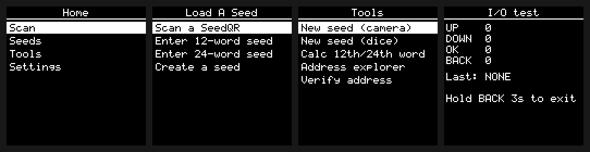
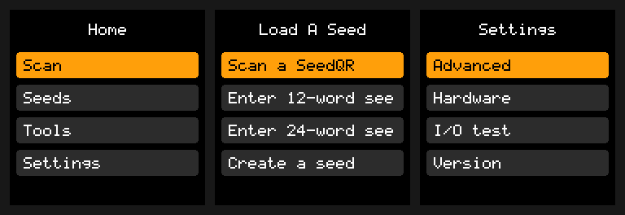

# Leek BTC Signer

**A stateless, air-gapped Bitcoin signer for the ESP32-S3**, inspired by
[SeedSigner](https://github.com/SeedSigner/seedsigner) and rebuilt in C for a
small board: a 1.5" monochrome OLED, a rotary encoder, four buttons, and a camera
for QR codes. The seed lives in RAM only. Unplug it and the seed is gone.

> **Status: in development. Not for real funds.** The Bitcoin core and PSBT
> signing are done and checked against SeedSigner itself. The camera, QR codes
> and the signing screens are next. Nothing has run on the physical board yet.



## Why

SeedSigner showed that a signing device can be stateless, cheap, built from
parts, and fully air-gapped, with QR codes as the only channel to the wallet.
Leek BTC Signer brings that design to an ESP32-S3 board that costs a few dollars.
It boots in a moment, has no operating system, and has no radio stack in the
firmware at all.

It follows SeedSigner closely on purpose:

- **The same flows and menus:** Scan, Seeds, Tools, Settings.
- **The same SeedQR format.**
- **The same PSBT checks.** The Bitcoin logic is ported from SeedSigner and
  tested against SeedSigner's own code, so the device accepts, rejects, reviews
  and signs a PSBT the way SeedSigner does.

## What it does

| | Status |
|---|---|
| Seed from SeedQR (standard and compact), word entry, dice, coin flips | Logic done; screens next |
| BIP-39 passphrase, fingerprint, BIP-85 child seeds | Logic done |
| xpub export: native and nested segwit, taproot, legacy, multisig paths, SLIP-132 versions | Logic done |
| PSBT review: change detection, fee, OP_RETURN, the anti-forgery checks | Done |
| PSBT signing: ECDSA and taproot key path | Done |
| Address verification | Logic done |
| QR decoding: UR, BBQr, Specter, base64/base43 PSBTs, every SeedQR form, addresses, sign-message | Done on the host, matches SeedSigner frame by frame |
| QR output: SeedQR, xpubs (static, Specter, UR), animated UR PSBTs | Done on the host, matches SeedSigner part by part |
| Camera scanning, the scan and QR screens | Next (camera needs the board) |
| Optional vault for a stored seed, opt-in and at the user's own risk | Phase 5 |

Each status has evidence behind it in [ROADMAP.md](ROADMAP.md).

## How it is verified

There's no board on the bench yet, so everything is proven in three tiers
([docs/TESTING.md](docs/TESTING.md)):

1. **Host:** the firmware's own C, compiled with gcc under AddressSanitizer and
   UBSan, for every display profile.
2. **QEMU:** the real ESP32-S3 firmware image, on Espressif's emulator.
   - The same test suites run inside it at boot, so the code is proven on the
     Xtensa build, not only on x86.
   - A serial harness lets scripts drive the menus and read back every frame.
3. **Board:** camera, OLED, encoder, timing, real entropy. When it arrives.

**The test vectors come from SeedSigner itself.** The scripts in
[`scripts/vectors/`](scripts/vectors/) run SeedSigner's Python code under the
embit version it pins and record what it does:

| What | Vectors | Result |
|---|---|---|
| Paths, xpubs, addresses, xpub exports, SeedQR, dice, BIP-85 | 290 | all match |
| Every PSBT SeedSigner's own test suite parses | 207 | see below |
| QR scans (SeedSigner's own decode tests and generated ones), frame by frame | 515 scans, 4827 frames | all match; descriptors wait for multisig |
| QR type detection | 2756 frames | all match |
| QR output parts | 6246 | all identical |

The PSBT cases break down like this:

| PSBT cases | Result |
|---|---|
| 43 | Rejected with SeedSigner's exact error |
| 155 | Reviewed identically |
| 135 | Signed byte-for-byte as SeedSigner signs them |
| 20 | Taproot: our signature and SeedSigner's both verify as valid BIP-340 |
| 9 | Refused on purpose (see below) |

**Deliberate mutations prove the tests catch real bugs.** Eleven times, the
security logic was broken on purpose: for example, skipping the forged-output
check, or checking inputs before outputs. The suites failed every time.

### Where it is stricter than SeedSigner

- **A PSBT with no outputs is refused.** SeedSigner reviews it as everything
  going to fees, with no high-fee warning.
- **An input without UTXO data is refused.**
- **An input asking for a sighash other than ALL is refused,** rather than left
  silently unsigned.

## Hardware

The bench setup is an ESP32-S3-WROOM-1-N16R8 CAM board with an OV5640 camera,
plus:

- a 1.5" SH1107 128x128 OLED,
- a four-button module (UP, DOWN, BACK, OK),
- an EC11 rotary encoder whose push is wired to OK.

Wiring, pin map, and a first-boot checklist are in
[docs/HARDWARE.md](docs/HARDWARE.md).

**The display is a build-time profile.** The same code drives a 128x64 SSD1306,
and later the colour ST7789/ST7735 modules, using SeedSigner's own palette:



## Build and test

ESP-IDF 5.5 is pinned through PlatformIO (`espressif32@6.12.0`). Every
dependency is vendored, so builds fetch nothing.

```sh
./scripts/check.sh                 # everything below, as CI runs it

make -C sim test                   # host suites, all display profiles
make -C sim shots                  # screenshots of every screen
make -C sim sim PROFILE=OLED128    # desktop simulator (SDL2): arrows, Enter, Esc
./sim/build/OLED128/leek-sim

./scripts/qemu.sh --smoke                                  # boot the firmware in QEMU
./scripts/qemu.sh --env s3cam-qemu-selftest --selftest     # vector suites on Xtensa
./scripts/qemu-flow.py                                     # drive the menus in QEMU

pio run -e s3cam-dev -t upload     # the board, with a USB console
```

ESP-IDF refuses to build in a path that contains a space, so clone into a
plain path.

| Environment | Image |
|---|---|
| `s3cam` | Release: no console, no radios, no harness (each checked from the ELF) |
| `s3cam-dev` | The board with a USB-Serial-JTAG console |
| `s3cam-qemu` | QEMU, with the UI harness on UART0 |
| `s3cam-qemu-selftest` | QEMU, running the vector suites at boot |

## Layout

```
src/core/     pure C, host and device: gfx, input, screens, btc, psbt-review
src/hal/      ESP-IDF only: OLED driver, input polling, QEMU harness
components/   libwally-core + secp256k1-zkp, vendored and pinned
sim/          host tests, generated vectors, screenshots, SDL simulator
scripts/      QEMU, image checks, vector generators
docs/         hardware, testing
```

## Acknowledgements

- **[SeedSigner](https://github.com/SeedSigner/seedsigner)** (MIT) is the model
  for this project's design, flows, SeedQR format and PSBT checks, and the
  source of its test vectors. Thank you to its contributors. Leek BTC Signer is
  independent and not affiliated with or endorsed by SeedSigner.
- **LeekWallet**, an ESP32-S3 EVM hardware wallet by the same author, provides
  the board support, OLED and button handling. Its Zcash firmware provides the
  encoder decoder.
- **[libwally-core](https://github.com/ElementsProject/libwally-core)** and
  **secp256k1-zkp** do the cryptography, as they do in Blockstream's Jade.

The full inventory is in [THIRD-PARTY-LICENSES.md](THIRD-PARTY-LICENSES.md).

## License

Apache-2.0. See [LICENSE](LICENSE) and [NOTICE](NOTICE).
